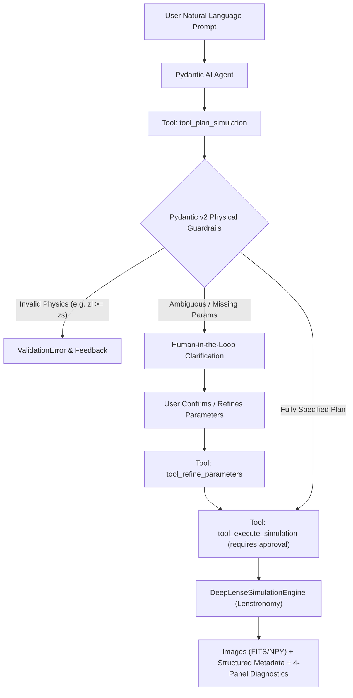

# DeepLense Agentic AI: Autonomous Lensing Simulation Pipeline

[](https://deeplense.streamlit.app)
[](https://www.python.org/downloads/)
[](https://docs.pydantic.dev/)
[](https://ai.pydantic.dev/)
[](https://github.com/lenstronomy/lenstronomy)
[]()

> **Submission for Google Summer of Code (GSoC) 2026**  
> **Organization**: Machine Learning for Science (ML4SCI) / CERN  
> **Project**: DeepLense — Specific Test II (Agentic AI)  
> **Live demo**: [deeplense.streamlit.app](https://deeplense.streamlit.app)  
> **Simulation Engine**: Wrapping [mwt5345/DeepLenseSim](https://github.com/mwt5345/DeepLenseSim) with modern Lenstronomy

---

## 1. Overview & Objectives

In strong gravitational lensing, the path of light from a distant background galaxy is deflected by the gravitational potential of an intervening massive foreground galaxy or cluster. Detecting subtle perturbations caused by **dark matter substructure** (such as Cold Dark Matter subhalos or ultra-light axion vortex filaments) is a cornerstone of the DeepLense project.

This repository implements an autonomous **Agentic Workflow** using **Pydantic AI** that wraps the DeepLense simulation pipeline. It enables researchers to generate, validate, and inspect strong gravitational lensing simulations through natural language dialogue while strictly adhering to astrophysical laws and survey systematics.

---

## 2. Key Architecture & Strategy Discussion

### Why Pydantic AI?
When choosing between Pydantic AI and other frameworks (such as Orchestral AI or LangChain):
1. **Type Safety & Physical Guardrails**: Gravitational lensing simulations rely on physical boundaries ($0 < z_{\text{lens}} < z_{\text{source}}$, positive Einstein radii $\theta_E$, valid mass ranges). Pydantic v2 validates inputs at compiled speeds *before* expensive simulations are triggered.
2. **Native Tool Calling**: Pydantic AI seamlessly registers Python functions with automatic docstring and type schema extraction.
3. **Deterministic & Model-Agnostic Execution**: Works with Gemini, OpenAI, Claude, local Ollama models, or deterministic fallback models for zero-cost offline testability.



---

## 3. Supported Model Configurations & Dark Matter Physics

Defaults follow the reference [DeepLenseSim](https://github.com/mwt5345/DeepLenseSim) code: $z_l = 0.5$, $z_s = 1.0$, an SIE main halo of $10^{12} M_\odot$ ($\theta_E \approx 1.66''$) with $e_1 = 0.1$ and external shear $\gamma_1 = 0.05$.

| Configuration | Instrument | Resolution | Pixel scale | PSF / noise | Source |
| :--- | :--- | :---: | :---: | :--- | :--- |
| **Model I** | Generic optical benchmark | 150 × 150 | 0.05″ | Gaussian FWHM 0.087″, background RMS 0.01, $t_{exp} \sim 10^{U(3,3.5)}$ s | Sérsic (amplitude units) |
| **Model II** | Euclid VIS (lenstronomy config) | 64 × 64 | 0.101″ | Gaussian 0.16″, sky 22.3 mag/″², read noise, 4 × 566 s | Sérsic, mag 20 |
| **Model III** | HST WFC3 F160W (lenstronomy config) | 64 × 64 | 0.08″ | Gaussian 0.08″, sky 22.3 mag/″², 5400 s | Sérsic, mag 20 |
| **Model IV** | Euclid VIS (lenstronomy config) | 64 × 64 | 0.101″ | as Model II, plus two-component Sérsic lens light; $\theta_E = 1.5''$, round SIE | Interpolated galaxy image |

Model IV's source is a real galaxy image through lenstronomy's `INTERPOL` profile. Pass `source_params.galaxy_image_path` pointing at `Galaxy10_DECals.h5` (class 6, $z < 0.02$, as in DeepLenseSim) or any `.npy`/`.fits`/`.png` image; without one, a seeded procedural spiral (bulge, logarithmic arms, star-forming clumps) is used so the model works out of the box.

### Dark Matter Substructure Classes
1. **`no_sub`**: Smooth SIE + external shear.
2. **`cdm`**: 25 point-mass subhalos with masses in $[10^6, 10^{10}] M_\odot$ from $dN/dm \propto m^{\beta}$ ($\beta = -0.9$ as in DeepLenseSim; set $-1.9$ for the CDM-theory slope), placed at $r \sim U(0.25'', 2'')$. Optional Poisson count.
3. **`axion`**: A vortex string of 100 point masses ($3 \times 10^{10} M_\odot$ total) through the lens center, half-length set by the de Broglie scale $\lambda \propto 1/m_a$; $m_a$ is drawn log-uniformly from $10^{-24}$ to $10^{-22}$ eV per image unless given.

The main $\theta_E$ comes from the halo mass (point-mass relation, as DeepLenseSim), a velocity dispersion ($\theta_E = 4\pi(\sigma/c)^2 D_{ls}/D_s$), or a direct value.

### Outputs and diagnostics
- **Arc SNR**: $\sum \text{arc} / \sqrt{\sum \sigma^2}$ over pixels where the noiseless lensed source exceeds the background RMS, with $\sigma^2 = \sigma_{bkg}^2 + \text{model}/t_{exp}$. The best single-pixel SNR is reported too.
- **Convergence maps** are pixel-averaged: point masses deposit $\pi\theta_E^2$ into their pixel, so CDM subhalos and vortices are visible (lenstronomy's analytic $\kappa$ of a point mass is a delta function and would show nothing).
- **Reproducibility**: all randomness (substructure, source position, exposure, noise) comes from one seeded generator; the seed is drawn and recorded when not given, so any run can be replayed exactly.

### Differences from DeepLenseSim
Reading the reference code, a few issues stand out that this implementation avoids: in `lens.py` the Model II/III path computes noise but stores `image_real = image_model + image_model`, `set_instrument` only has a Euclid branch, and the Einstein radius uses luminosity distances with $D_{ls} = D_s - D_l$ (here: angular diameter distances). Model IV there uses pyHalo realizations for substructure; here Model IV uses the same CDM/axion generators as Models I-III so all four configurations share one substructure definition.

---

## 4. Human-in-the-Loop (HITL) Workflow

When a user submits an under-specified prompt (e.g., *"Simulate a lens with subhalos"*), the agent:
1. Detects omitted parameters (e.g., redshifts, instrument survey).
2. Proposes physically plausible cosmological values (DeepLense defaults $z_l=0.5, z_s=1.0$).
3. Returns structured `ClarificationQuestion` items with the **scientific rationale** explaining why those parameters matter.
4. Pauses compute execution until the user reviews, refines, or confirms.

The pause is enforced by the framework, not just the prompt: `tool_execute_simulation` is registered with `requires_approval=True`, so an agent run that wants to simulate ends with a `DeferredToolRequests` and only continues when the session passes back the user's approval (`session.approve()`) or denial (`session.reject(reason)`). Invalid physics (e.g. $z_l \ge z_s$) raised by the Pydantic guardrails is returned to the LLM as `ModelRetry`, so it can explain the problem and propose valid values.

Without an LLM configured, `DeepLenseWorkflowSession` falls back to a deterministic rule-based parser that drives the same tools, so tests and demos run offline.

---

## 5. Repository Structure

```
.
├── deeplense_agent/                  # Core Python package
│   ├── models/                       # Pydantic parameter & response models
│   │   ├── parameters.py             # Astrophysical constraints & models
│   │   └── responses.py              # Structured metadata & HITL questions
│   ├── simulation/                   # Physics simulation engine
│   │   ├── instruments.py            # Model I–IV survey profiles
│   │   ├── substructures.py          # Dark matter physics (SIE, CDM, Axion)
│   │   ├── sources.py                # Model IV galaxy sources (Galaxy10 / images / procedural)
│   │   └── core.py                   # Lenstronomy wrapper & batch runner
│   ├── agent/                        # Pydantic AI agent & workflow
│   │   ├── prompts.py                # Astrophysical system prompts
│   │   ├── tools.py                  # Agent tools (plan, refine, simulate, inspect)
│   │   ├── agent.py                  # Pydantic AI agent factory
│   │   └── workflow.py               # Multi-turn HITL session controller
│   └── visualization/
│       └── plotting.py               # 4-panel astrophysical diagnostic suite
├── notebooks/
│   └── deeplense_agentic_workflow.ipynb # Complete interactive demonstration notebook
├── tests/                            # Automated test suite (37 tests)
│   ├── test_models.py                # Pydantic validation tests
│   ├── test_simulation.py            # Simulation output & SNR tests
│   ├── test_physics.py               # Physics sanity checks & parameter tools
│   └── test_workflow.py              # Tool registration & HITL dialogue tests
├── app.py                            # Streamlit web app
├── requirements.txt                  # Python dependencies
├── pytest.ini                        # Pytest configuration
└── README.md                         # Documentation
```

---

## 6. Installation & Quickstart

### Prerequisites
- Python 3.10+
- Virtual environment (recommended)

### Setup
```bash
git clone <your-repository-url>
cd gsoc
python3 -m venv venv
source venv/bin/activate
pip install -r requirements.txt
```

### Running Unit Tests
```bash
pytest tests/
```
The full suite runs in about two seconds:
```text
tests/test_models.py ....                                                [ 10%]
tests/test_physics.py ................                                   [ 54%]
tests/test_simulation.py ....                                            [ 64%]
tests/test_workflow.py .............                                     [100%]
============================== 37 passed in 2.26s ==============================
```

### Web App

```bash
streamlit run app.py
```

Pick a model in the sidebar and paste an API key, or use the offline parser. To deploy on [Streamlit Community Cloud](https://share.streamlit.io), push the repo to GitHub, create an app pointing at `app.py`, and optionally add a server key under *Settings → Secrets*:

```toml
GROQ_API_KEY = "gsk_..."        # default model: openai/gpt-oss-120b on Groq
# ANTHROPIC_API_KEY = "sk-ant-..."  # or any other supported provider
```

Keys typed in the sidebar are passed directly to the model provider for that browser session and are never written to the environment.

### Interactive Usage Example
```python
from deeplense_agent import DeepLenseWorkflowSession

# 1. LLM agent (needs GROQ_API_KEY); any pydantic-ai model or model string works.
#    DeepLenseWorkflowSession() with no model uses the offline rule-based parser.
session = DeepLenseWorkflowSession(agent_llm="groq:openai/gpt-oss-120b")

# 2. The agent builds a validated plan and flags defaulted values
r1 = session.chat("Axion vortex lens on HST with z_source 2, 3 images, seed 11")
print(r1.plan.summary)

# 3. Nothing runs until a human approves ("yes" in chat, or session.approve()).
#    Any other reply is passed back to the agent as a requested change.
r2 = session.chat("yes")
print(r2.execution_output.random_seed, r2.bundle.images_observed.shape)

# 4. Render the 4-panel diagnostic figure
session.plot_latest()
```

---

## 7. Jupyter Notebook Deliverable

The comprehensive demonstration notebook is located at:
`notebooks/deeplense_agentic_workflow.ipynb`

It includes:
1. Complete strategy and framework discussion.
2. Pydantic validation and guardrail checks.
3. Multi-turn HITL interactive conversation.
4. Embedded high-resolution Matplotlib figures:
   - Observed mock telescope images.
   - Dark matter convergence ($\kappa$) maps showing subhalo/vortex perturbations.
   - Unlensed source galaxy planes.
   - Radial surface brightness profiles.
5. Comparative gallery across all four configurations (Model I, II, III and IV).
6. Structured metadata extraction and evaluation tables.

**A note on the 90:10 train-test split:** that requirement applies to the ML tasks. Specific Test II trains no model, so there is no validation split and no weights to submit. This submission is evaluated on agent architecture, simulation correctness (covered by `tests/test_physics.py`), structured output validation and modularity, as listed in section 8.

---

## 8. Compliance with GSoC 2026 Evaluation Metrics

- **Agent architecture and tool design**: Pydantic AI agent with typed tools covering every physical knob; plan and refine share one validated update path; execution gated by `requires_approval`; invalid physics returned to the LLM as `ModelRetry`. Works with Groq, Anthropic, OpenAI or Gemini, and offline.
- **Correctness of simulations**: lenstronomy survey configurations for Euclid and HST, DeepLenseSim-matched lens and substructure models, seeded noise, and physics tests (Einstein radius scalings, noise level vs reported background, SNR vs magnitude, substructure placement, vortex length vs axion mass).
- **Structured output validation**: every run returns Pydantic models with per-image Einstein radius, arc SNR, exposure, background, source position, substructure mass and the reproducing seed.
- **Code modularity**: data contracts, physics, agent orchestration, visualization and the Streamlit app are separate layers.
