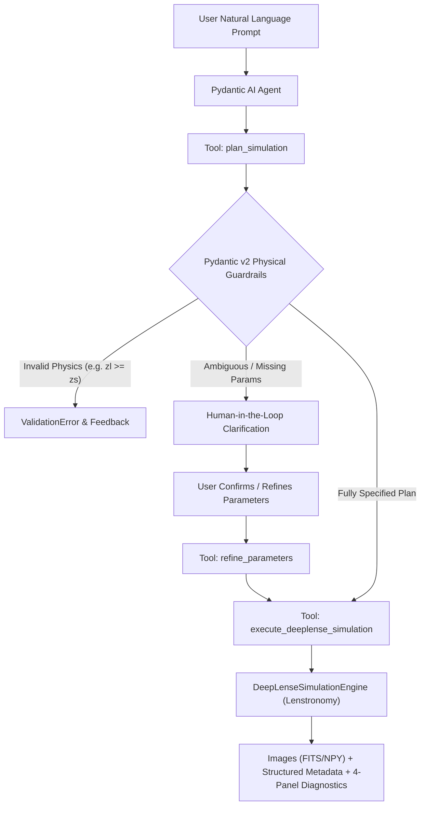

# DeepLense Agentic AI: Autonomous Lensing Simulation Pipeline

[](https://www.python.org/downloads/)
[](https://docs.pydantic.dev/)
[](https://ai.pydantic.dev/)
[](https://github.com/lenstronomy/lenstronomy)
[]()

> **Submission for Google Summer of Code (GSoC) 2026**  
> **Organization**: Machine Learning for Science (ML4SCI) / CERN  
> **Project**: DeepLense — Specific Test II (Agentic AI)  
> **Simulation Engine**: Wrapping [mwt5345/DeepLenseSim](https://github.com/mwt5345/DeepLenseSim) with modern Lenstronomy

---

## 1. Overview & Objectives

In strong gravitational lensing, the path of light from a distant background galaxy is deflected by the gravitational potential of an intervening massive foreground galaxy or cluster. Detecting subtle perturbations caused by **dark matter substructure** (such as Cold Dark Matter subhalos or ultra-light axion vortex filaments) is a cornerstone of the DeepLense project.

This repository implements an autonomous **Agentic Workflow** using **Pydantic AI** that wraps the DeepLense simulation pipeline. It enables researchers to generate, validate, and inspect strong gravitational lensing simulations through natural language dialogue while strictly adhering to astrophysical laws and survey systematics.

---

## 2. Key Architecture & Strategy Discussion

### Why Pydantic AI?
When choosing between Pydantic AI and other frameworks (such as Orchestral AI or LangChain):
1. **Type Safety & Physical Guardrails**: Gravitational lensing simulations rely on physical boundaries ($0 < z_{\text{lens}} < z_{\text{source}}$, positive Einstein radii $\theta_E$, valid mass ranges). Pydantic v2 validates inputs at compiled speeds *before* expensive simulations are triggered.
2. **Native Tool Calling**: Pydantic AI seamlessly registers Python functions with automatic docstring and type schema extraction.
3. **Deterministic & Model-Agnostic Execution**: Works with Gemini, OpenAI, Claude, local Ollama models, or deterministic fallback models for zero-cost offline testability.



---

## 3. Supported Model Configurations & Dark Matter Physics

Our architecture supports all four DeepLense paper configurations across all three dark matter substructure classes:

| Configuration | Instrument / Survey | Resolution | Pixel Scale | PSF / Systematics | Typical SNR |
| :--- | :--- | :---: | :---: | :--- | :---: |
| **Model I** | Ground-Based Benchmark | 150 × 150 px | 0.05" / px | Gaussian PSF ($\text{FWHM}=0.087''$), Background noise | ~25 |
| **Model II** | Space-Based Euclid VIS Survey | 64 × 64 px | 0.10" / px | Euclid VIS diffraction-limited optics | ~80 |
| **Model III** | Space-Based Hubble Space Telescope (HST) | 64 × 64 px | 0.05" / px | HST WFC3/ACS F814W characteristics | ~40 |
| **Model IV** | High-Fidelity Euclid Extended | 64 × 64 px | 0.10" / px | Extended realistic morphology | ~80 |

### Dark Matter Substructure Classes:
1. **`no_sub`**: Smooth Singular Isothermal Ellipsoid (SIE) + External Shear ($\gamma_1, \gamma_2$).
2. **`cdm`**: Cold Dark Matter subhalo population drawn from a power-law subhalo mass function ($dN/dm \propto m^\beta$) distributed in an annulus around the critical curve.
3. **`axion`**: Ultra-light axion / Wave Dark Matter vortex filaments parameterized by de Broglie wavelength scale $\lambda_{\text{dB}} \propto 1 / m_a$.

---

## 4. Human-in-the-Loop (HITL) Workflow

When a user submits an under-specified prompt (e.g., *"Simulate a lens with subhalos"*), the agent:
1. Detects omitted parameters (e.g., redshifts, instrument survey).
2. Proposes physically plausible cosmological values ($z_l=0.5, z_s=1.5$).
3. Returns structured `ClarificationQuestion` items with the **scientific rationale** explaining why those parameters matter.
4. Pauses compute execution until the user reviews, refines, or confirms.

---

## 5. Repository Structure

```
.
├── deeplense_agent/                  # Core Python package
│   ├── models/                       # Pydantic parameter & response models
│   │   ├── parameters.py             # Astrophysical constraints & models
│   │   └── responses.py              # Structured metadata & HITL questions
│   ├── simulation/                   # Physics simulation engine
│   │   ├── instruments.py            # Model I–IV survey profiles
│   │   ├── substructures.py          # Dark matter physics (SIE, CDM, Axion)
│   │   └── core.py                   # Lenstronomy wrapper & batch runner
│   ├── agent/                        # Pydantic AI agent & workflow
│   │   ├── prompts.py                # Astrophysical system prompts
│   │   ├── tools.py                  # Agent tools (plan, refine, simulate, inspect)
│   │   ├── agent.py                  # Pydantic AI agent factory
│   │   └── workflow.py               # Multi-turn HITL session controller
│   └── visualization/
│       └── plotting.py               # 4-panel astrophysical diagnostic suite
├── notebooks/
│   └── deeplense_agentic_workflow.ipynb # Complete interactive demonstration notebook
├── tests/                            # Automated test suite (11 unit tests)
│   ├── test_models.py                # Pydantic validation tests
│   ├── test_simulation.py            # Simulation output & SNR tests
│   └── test_workflow.py              # Tool registration & HITL dialogue tests
├── requirements.txt                  # Python dependencies
├── pytest.ini                        # Pytest configuration
└── README.md                         # Documentation
```

---

## 6. Installation & Quickstart

### Prerequisites
- Python 3.10+
- Virtual environment (recommended)

### Setup
```bash
git clone <your-repository-url>
cd gsoc
python3 -m venv venv
source venv/bin/activate
pip install -r requirements.txt
```

### Running Unit Tests
```bash
pytest tests/
```
All 11 tests will pass with complete validation:
```text
tests/test_models.py ....                                                [ 36%]
tests/test_simulation.py ....                                            [ 72%]
tests/test_workflow.py ...                                               [100%]
============================== 11 passed in 1.72s ==============================
```

### Interactive Usage Example
```python
from deeplense_agent import DeepLenseWorkflowSession

# 1. Initialize session
session = DeepLenseWorkflowSession()

# 2. Turn 1: High-level prompt
r1 = session.chat("Simulate a strong gravitational lens with CDM subhalos.")
print(r1.message)  # Prompts with HITL questions for redshifts and survey

# 3. Turn 2: User clarification and confirmation
r2 = session.chat("Use Euclid Model_II with z_lens=0.5 and z_source=1.5, please execute.")
print(r2.message)  # Confirms simulation execution and displays metadata

# 4. Render 4-panel diagnostic figure
session.plot_latest()
```

---

## 7. Jupyter Notebook Deliverable

The comprehensive demonstration notebook is located at:
`notebooks/deeplense_agentic_workflow.ipynb`

It includes:
1. Complete strategy and framework discussion.
2. Pydantic validation and guardrail checks.
3. Multi-turn HITL interactive conversation.
4. Embedded high-resolution Matplotlib figures:
   - Observed mock telescope images.
   - Dark matter convergence ($\kappa$) maps showing subhalo/vortex perturbations.
   - Unlensed source galaxy planes.
   - Radial surface brightness profiles.
5. Comparative gallery across Model I, Model II, and Model III.
6. Structured metadata extraction and evaluation tables.

---

## 8. Compliance with GSoC 2026 Evaluation Metrics

- **Quality of agent architecture and tool design**: Modular Pydantic AI agent with 4 registered tools and dedicated session state management.
- **Correctness of generated simulations**: Physics-grounded cosmology solving the lens equation with proper angular diameter distances ($D_l, D_s, D_{ls}$) and Poisson/detector noise.
- **Structured output validation**: Every simulation delivers strongly typed Pydantic models with dimensions, SNR, Einstein radii, and subhalo counts.
- **Code modularity**: Clean separation between data contracts, astrophysics solvers, agent orchestration, and visualization.
